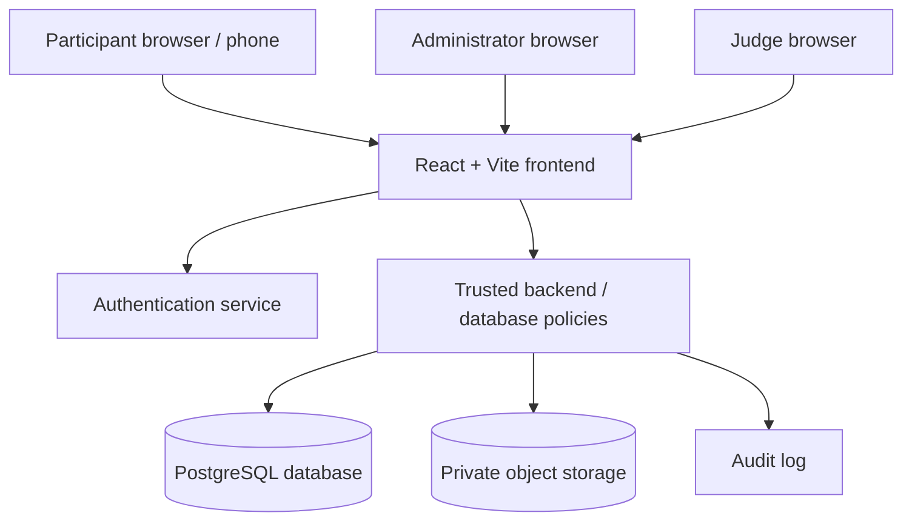
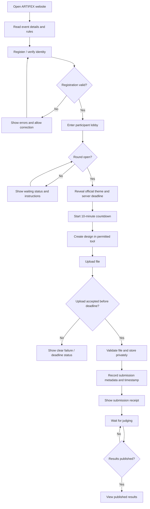

# ARTIFEX Website: Complete Architecture, Workflow & Implementation Specification

**Event:** ARTIFEX --- Creative Design Competition\
**Context:** Techvidya\
**Document purpose:** A complete blueprint for designing, building,
deploying, operating, and evaluating the ARTIFEX event website.\
**Version:** 1.0\
**Status:** Proposed architecture; confirm event-specific decisions
marked **\[DECIDE\]** before implementation.

------------------------------------------------------------------------

## 1. Product Overview

ARTIFEX is an individual creative-design competition. Every participant
receives the same theme or occasion and has **10 minutes** to create an
original poster or flyer using a permitted digital design tool. The
participant must submit the design before the deadline. Judges evaluate
the submitted designs, and their decision is final.

The website should make the event easy to operate under time pressure:
participants understand the rules, enter the competition, see the theme
and countdown at the correct time, submit a file, receive clear
submission confirmation, and wait for results. Organisers need reliable
control over the event, the timer, submissions, eligibility, judging,
and results.

### 1.1 Primary objectives

1.  Deliver the same theme and start/end times to all eligible
    participants.
2.  Enforce the 10-minute competition window consistently.
3.  Support individual participation only.
4.  Accept submissions in a controlled digital format.
5.  Prevent accidental loss, duplicate ambiguity, late-submission
    disputes, and unauthorised access.
6.  Give organisers a clear live view of participants, timing, and
    submission status.
7.  Give judges a consistent, manageable review workflow.
8.  Preserve an audit trail for important actions.
9.  Work on common phones and laptops, with a desktop-friendly design
    workspace experience.
10. Remain stable when many participants open the site at the same time.

### 1.2 Non-goals

Unless the organisers explicitly choose otherwise, the website does
**not** need to: - Provide a built-in poster editor. - Replace Canva,
Figma, Photoshop, Illustrator, or other permitted design tools. - Allow
teamwork or team submissions. - Generate designs automatically. -
Guarantee that a design is human-created merely because it is
uploaded. - Decide winners automatically using AI. - Publish
participants' files publicly by default.

------------------------------------------------------------------------

## 2. Competition Rules the Website Must Enforce

  -----------------------------------------------------------------------
  Rule                                Website behaviour
  ----------------------------------- -----------------------------------
  Common theme                        One official theme is announced to
                                      all participants for the round.

  Time limit                          A single authoritative 10-minute
                                      window is used for the round.

  Individual competition              One registered participant submits
                                      their own work; no team workflow
                                      exists.

  Permitted tools                     Display the approved tools: Figma,
                                      Canva, Adobe Photoshop, Adobe
                                      Illustrator, and other tools
                                      permitted by organisers.

  Originality                         Display the originality rule and
                                      require a participant declaration
                                      before submission.

  Theme relevance                     Judges evaluate whether the work
                                      communicates the given theme.

  Required design elements            Rules specify a suitable headline,
                                      relevant visuals, and a clear
                                      message; supporting text must fit
                                      the theme.

  Digital submission                  Accept only the configured file
                                      types and size limits.

  Deadline                            Close submissions at the official
                                      deadline and show a clear status.

  No copying/sharing/modifying        Display the prohibition and include
                                      it in the participant declaration.

  Judges' final decision              Display this rule on the rules page
                                      and results page.
  -----------------------------------------------------------------------

**Important:** A declaration and audit trail support fair
administration, but they cannot technically prove that a design is
original. If originality disputes arise, the event organisers must
review them.

------------------------------------------------------------------------

## 3. Roles and Permissions

Use role-based access control (RBAC). A person should only see and do
what their role permits.

### 3.1 Participant

Can: - Read event details and rules. - Register or verify their event
entry. - View their own profile and submission status. - View the theme
and countdown after the organiser opens the round. - Upload their own
design while submissions are open. - Replace their submission before the
deadline **only if the organiser enables replacement**. - See submission
confirmation and any published results.

Cannot: - Start, pause, extend, or end the round. - View another
participant's private submission. - Change the official theme or event
timer. - View judge scores or private comments before publication. -
Submit on behalf of a team. - Alter the submission timestamp or
deadline.

### 3.2 Event administrator / organiser

Can: - Configure the event name, instructions, date, allowed file
formats, and file-size limit. - Create and edit the theme before the
round begins. - Preview participant-facing pages. - Open registration
and close registration. - Start the round manually. - Pause or resume
the round if the policy allows it. - End the round manually. - Apply a
documented extension or reopen policy. - View live participant and
submission status. - Export operational data. - Manage judge accounts
and event settings. - Publish results. - Review the audit log.

Administrator safeguards: - Require authenticated access. - Protect
high-impact actions with a confirmation step. - Record who performed
each action and when. - Avoid storing admin credentials in frontend
code. - Prefer two-person approval for changing a deadline or reopening
submissions if the event's scale warrants it.

### 3.3 Judge

Can: - Access only assigned judging material. - Review submissions in a
secure gallery or one-at-a-time review view. - Score using the agreed
rubric. - Add internal comments. - Save drafts and submit final
scores. - Mark a submission for a possible rule violation.

Cannot: - Change the event timer or official theme. - Modify a
participant's uploaded file. - See participant identity during blind
judging, if blind judging is enabled. - Publish results unless
separately granted that permission.

### 3.4 Super administrator / technical operator (optional)

Use only if the event needs separate technical administration. This role
manages platform-level settings and access recovery. It should not be
necessary for routine judging.

------------------------------------------------------------------------

## 4. Recommended Technology Architecture

A practical, maintainable option for a student event website is:

### Frontend

-   **React + Vite** for the single-page application.
-   **TypeScript** recommended for safer timer, form, and submission
    logic.
-   **Tailwind CSS** for responsive styling.
-   A component library or accessible custom components for dialogs,
    forms, tables, alerts, and tabs.
-   A lightweight routing library, such as React Router.

### Backend and data

Recommended managed option: - **Supabase Auth** for participant, judge,
and organiser authentication. - **PostgreSQL** for event configuration,
registrations, submissions metadata, scores, and audit logs. -
**Supabase Storage** for uploaded design files, with private buckets. -
**Row Level Security (RLS)** for database access rules. - Realtime
features only where useful, such as live submission status. The server
remains the authority for time and state.

Alternative: - Node.js + Express API and PostgreSQL, with object storage
such as an S3-compatible service. This provides more control but
increases deployment and maintenance work.

### Hosting

-   Frontend: Vercel or another static frontend host.
-   Backend/database/storage: Supabase, or a separately deployed API and
    database.
-   Domain: a dedicated event subdomain if available.

### Recommended high-level choice

For a time-limited college event, React + Vite + Tailwind + Supabase is
a strong balance of speed and maintainability. Keep sensitive rules and
permissions in the database/backend, not only in React.

------------------------------------------------------------------------

## 5. System Context and Architecture Diagram



### 5.1 Trust boundaries

-   The browser is untrusted. A user can manipulate client-side
    JavaScript, local time, network requests, or form values.
-   The server/database is authoritative for role, round status,
    deadline, accepted file types, and submission eligibility.
-   Storage must be private. A public bucket can expose every
    participant's design through guessed or shared URLs.
-   Judge comments and unpublished scores are confidential.
-   The frontend must never contain service-role keys, database
    passwords, private signing secrets, or admin API secrets.

------------------------------------------------------------------------

## 6. Main Website Information Architecture

### 6.1 Public pages

1.  **Landing page**
    -   ARTIFEX name and event identity.
    -   One-line explanation: creative poster/flyer competition.
    -   Event date/time and venue or online participation details, if
        applicable.
    -   Registration status.
    -   Primary action: Register / Enter Event.
    -   Secondary action: View Rules.
    -   Short event flow: Register → Read theme → Design for 10 minutes
        → Submit → Results.
2.  **Rules and guidelines**
    -   All official rules in plain language.
    -   Permitted tools.
    -   Originality and no-copying policy.
    -   Accepted file types and maximum size.
    -   Deadline policy.
    -   Judging rubric, if approved for public release.
    -   Contact or help desk instructions.
3.  **Registration**
    -   Fields configured by the organisers, for example full name,
        college ID/USN, email, and phone if genuinely needed.
    -   Avoid collecting unnecessary personal data.
    -   Validate required fields and duplicates.
    -   Show a clear confirmation after successful registration.
    -   **\[DECIDE\]** Whether registration uses email OTP, college ID
        plus access code, or organiser-created participant accounts.
4.  **Participant lobby**
    -   Registration status.
    -   Event status: Not started / Registration closed / Ready / Live /
        Submission closed / Results published.
    -   Rules acknowledgement.
    -   Theme area, hidden until the organiser chooses to reveal it.
    -   Instructions for what to do when the round opens.
5.  **Live competition workspace**
    -   Official theme and short brief.
    -   Countdown timer.
    -   Submission status.
    -   Upload area.
    -   Accepted file types and size.
    -   Originality declaration.
    -   Help / troubleshooting link.
6.  **Submission receipt**
    -   Submission received status.
    -   Official server-recorded submission time.
    -   File name and reference number.
    -   Whether replacement is allowed.
    -   Clear warning not to close the page until the upload finishes,
        without implying the page must stay open after a confirmed
        upload.
7.  **Results**
    -   Published ranking or winner announcement.
    -   Scoring summary if approved.
    -   Judges' decision is final.
    -   Do not reveal private judge comments unless intended.

### 6.2 Protected pages

-   Admin dashboard.
-   Event configuration.
-   Participant management.
-   Live event control.
-   Submission management.
-   Judge assignment.
-   Judge review workspace.
-   Score moderation and result publication.
-   Audit log.
-   Export/report page.

------------------------------------------------------------------------

## 7. Participant Journey: End-to-End Workflow



### 7.1 Registration behaviour

-   Validate inputs on both client and server.
-   Normalise identifiers such as USN before checking duplicates.
-   Prevent duplicate registrations for the same event unless organisers
    explicitly allow them.
-   Return actionable error messages, not raw database errors.
-   After successful registration, redirect to the lobby.
-   If the participant refreshes, they should return to their current
    state rather than register again.
-   Use an event-specific participant record so the platform can support
    future events without mixing entries.

### 7.2 Before the round starts

Show: - Event title and official rules. - "The theme will be revealed
when the organiser starts the round." - Accepted upload format(s) and
size limit. - Reminder that the competition is individual. - A visible
system status. - If the event is not open, do not start a
participant-side timer.

### 7.3 When the round starts

-   The organiser presses **Start Round**.
-   The backend records `started_at` using server time.
-   The backend calculates `deadline_at = started_at + 10 minutes`,
    unless an explicitly documented pause/extension policy changes it.
-   The theme becomes visible to all eligible participants.
-   The participant interface requests the official status and deadline
    from the server.
-   Each browser displays the remaining time derived from that deadline.
-   Do not create separate deadlines on individual devices.
-   If participants join late, show the time remaining in the same
    shared round; do not give each participant a fresh 10 minutes unless
    the event policy explicitly requires individual timing.

### 7.4 During the round

-   The countdown remains visible and readable.
-   Show the theme without forcing the participant to navigate away from
    the upload controls.
-   Permit file upload only while the server says submissions are open.
-   Show upload progress and retry guidance.
-   Prevent accidental duplicate clicks from creating multiple ambiguous
    submissions.
-   **\[DECIDE\]** Whether a participant can replace a previously
    accepted file before the deadline. If enabled, preserve submission
    history and identify the latest valid version.
-   Avoid automatic page refreshes that interrupt uploads.
-   If network connectivity is lost, show a reconnecting state. Do not
    claim a file is submitted until the server confirms it.

### 7.5 At the deadline

-   The server determines whether a submission is timely.
-   The frontend countdown is only a display, not the authority.
-   Reject new uploads or finalisation requests after the configured
    cutoff, subject to the event's documented grace-period policy.
-   If an upload began before the deadline but finishes after it, the
    policy must be explicit. Recommended options:
    1.  **Strict completion rule:** the server must finish receiving and
        validating the file before the deadline.
    2.  **Upload-start rule:** the server records a valid upload session
        initiated before the deadline and permits a short, fixed
        completion grace period.
-   Choose one policy before the event and display it clearly. Do not
    decide ad hoc for individual participants.
-   Lock submissions after closure.
-   Show "Submission window closed" and the participant's recorded
    status.

### 7.6 After submission

-   Create a durable submission record.
-   Display a receipt with server timestamp and submission reference.
-   Store files privately.
-   Keep the file unchanged after receipt. Any replacement should create
    a new version rather than silently overwrite history.
-   Notify the participant in the UI that their submission was received.
-   **\[DECIDE\]** Whether to send email confirmation. This is optional
    and should not be relied upon as the only receipt.

------------------------------------------------------------------------

## 8. Administrator Workflow

### 8.1 Pre-event setup checklist

1.  Create the event.
2.  Enter the event title, date, description, and official rules.
3.  Configure registration fields and duplicate policy.
4.  Configure the accepted file formats and maximum file size.
5.  Set the default duration to 10 minutes.
6.  Enter the theme and judging rubric.
7.  Set whether the theme is hidden until the round starts.
8.  Set whether submission replacement is allowed.
9.  Set the upload deadline policy and any grace period.
10. Create judge accounts and assign access.
11. Test the site using a test event or test participant accounts.
12. Verify the production environment variables.
13. Verify private storage permissions.
14. Confirm the event works on phones and laptops.
15. Export or back up the participant list as permitted by the privacy
    policy.
16. Confirm who can operate the event if the primary administrator's
    device fails.

### 8.2 Admin dashboard

Recommended cards: - Registered participants. - Participants currently
in the lobby. - Round status. - Time remaining. - Number of submissions
received. - Number of participants with no submission. - Upload failures
/ flagged errors. - Judge completion progress. - Recent administrative
actions.

Recommended live table columns: - Participant ID. - Participant name or
masked ID, depending on privacy requirements. - Registration status. -
Last activity (optional and privacy-conscious). - Submission status. -
Submission timestamp. - File validation status. - Rule-violation flag. -
Admin actions permitted for that row.

### 8.3 Start Round action

Before starting, show a confirmation dialog: - Theme to be revealed. -
Duration: 10 minutes. - Number of eligible participants. - Exact rule
for upload completion at the deadline. - Warning that the timer will
affect everyone. - Buttons: Cancel / Start Round.

On confirmation: - Backend checks admin permission. - Backend checks the
round is in a startable state. - Backend writes `started_at`,
`deadline_at`, and status. - Backend writes an audit event. - Frontend
refreshes from server state and shows the live round.

### 8.4 Pause, resume, extend, or end

These actions need a deliberate policy. For a short 10-minute
competition, **avoid pausing unless necessary**, because it can create
fairness disputes.

If pause/resume is supported: - Record pause time and reason. - Define
whether the deadline is shifted by the pause duration. - Show the same
state to all participants. - Record resume time and new deadline. - Make
the action visible in the audit log.

If an extension is needed: - Require a reason. - Apply it globally to
the round, not to a single participant, unless a published accommodation
policy says otherwise. - Record old and new deadline. - Announce the
extension to all participants.

If ending early: - Confirm the action. - Record who ended the round and
why. - Close new submissions according to the configured policy. -
Display the closure status to all participants.

### 8.5 Close, judge, publish

1.  Confirm submissions are closed.
2.  Review file-validation failures and any flagged cases.
3.  Assign submissions to judges.
4.  Judges score independently using the agreed rubric.
5.  Resolve missing or conflicting scores according to a predefined
    policy.
6.  Lock final scores.
7.  Review the proposed ranking.
8.  An authorised administrator publishes the results.
9.  Write a result-publication audit event.
10. Display the published results page.

------------------------------------------------------------------------

## 9. Judge Workflow and Scoring

### 9.1 Suggested judging rubric

The organisers should approve the exact rubric before the event. A
suggested 100-point rubric:

  ------------------------------------------------------------------------
  Criterion                                   Points What judges assess
  --------------------- ---------------------------- ---------------------
  Theme communication                             30 Does the poster
                                                     clearly communicate
                                                     the announced theme
                                                     or occasion?

  Originality and                                 25 Is the idea
  concept                                            distinctive rather
                                                     than a generic or
                                                     copied layout?

  Visual hierarchy and                            20 Is the headline
  readability                                        clear? Can the
                                                     message be understood
                                                     quickly?

  Visual design and                               15 Are typography,
  composition                                        spacing, alignment,
                                                     contrast, and visual
                                                     balance effective?

  Relevance and message                           10 Do visuals and
  clarity                                            supporting text
                                                     reinforce the theme?

  **Total**                                  **100** 
  ------------------------------------------------------------------------

This is a proposed rubric, not an automatic rule. It should be announced
before judging starts.

### 9.2 Review interface

Each submission review should include: - Submission ID. - Participant
identity only if blind judging is not enabled. - Image/file preview
where supported. - Download/open-original option for authorised
judges. - Scoring inputs for each criterion. - Optional private
comments. - Rule-violation flag with reason. - Save draft and submit
final score controls. - Status: Not started / Draft / Submitted /
Locked.

### 9.3 Fairness controls

-   Use the same rubric for all submissions.
-   Consider blind judging to reduce identity bias.
-   If multiple judges score each submission, define how the final score
    is calculated, for example the mean of valid scores.
-   Define tie-breaking criteria in advance.
-   Do not let judges silently edit scores after locking.
-   If a score changes after locking, require permission and an audit
    record.
-   Keep judge comments private unless the organisers explicitly intend
    to publish them.

------------------------------------------------------------------------

## 10. Submission System: File and Data Rules

### 10.1 Recommended upload settings

**\[DECIDE\]** The organisers must choose the exact file formats and
maximum size. A reasonable starting point is: - Accepted formats: PNG,
JPG/JPEG, and PDF. - Maximum file size: 10 MB per submission. - One
active submission per participant, with optional versioned replacement
before the deadline.

This is a recommendation, not a confirmed event requirement. If the
design must be editable, consider whether source files are necessary;
accepting source files increases complexity and can expose tool-specific
content.

### 10.2 Validation

Perform validation on the server: - Confirm the authenticated
participant is eligible for the event. - Confirm the round is open. -
Confirm the request is within the official deadline policy. - Confirm
the file size is within the configured limit. - Check file extension and
detected content type; do not trust the filename alone. - Use a
generated storage key rather than the original filename as the path. -
Reject unsupported or empty files. - Apply malware scanning if available
and proportionate to the event. - Avoid rendering arbitrary uploaded
HTML or SVG inline. If SVG is accepted, sanitise it or serve it as a
download. - Do not accept executable files. - Use signed, short-lived
URLs for authorised previews/downloads where supported.

### 10.3 Upload states

1.  `not_started`
2.  `selected`
3.  `uploading`
4.  `validating`
5.  `accepted`
6.  `failed`
7.  `rejected_late`
8.  `replaced` (if replacement is enabled)

Only show `accepted` after storage and database confirmation have
succeeded.

### 10.4 File naming and storage

Use generated object keys, for example:

`events/{event_id}/submissions/{submission_id}/{version_id}`

Do not use participant-supplied file names as trusted storage paths.
Preserve the original file name only as metadata after sanitising it for
display.

### 10.5 Integrity and version history

For each upload, record: - File size. - Detected MIME type. - Storage
key. - Server-received timestamp. - Validation outcome. - Optional
cryptographic checksum, such as SHA-256, for integrity verification. -
Version number. - Whether the version is the active submission.

Never silently overwrite an accepted file. Version history helps resolve
disputes.

------------------------------------------------------------------------

## 11. Countdown and Deadline Design

This is one of the most important reliability requirements.

### 11.1 Correct timing model

-   `started_at` and `deadline_at` are set by the backend/database.
-   All browsers read the same `deadline_at`.
-   The client calculates remaining time as
    `deadline_at - current_server_adjusted_time`.
-   The display may tick every second, but the server validates each
    submission against the official state.
-   Refreshing the browser must not reset the timer.
-   Changing the participant's device clock must not extend the
    deadline.
-   If the browser sleeps or loses connection, it must re-fetch round
    state on resume/reconnect.

### 11.2 Recommended event states

``` text
DRAFT
  -> REGISTRATION_OPEN
  -> REGISTRATION_CLOSED
  -> READY
  -> LIVE
  -> SUBMISSIONS_CLOSED
  -> JUDGING
  -> RESULTS_READY
  -> PUBLISHED
  -> ARCHIVED
```

Optional exceptional states: - `PAUSED` if pause policy is supported. -
`CANCELLED` if the event is cancelled. - `REOPENED` should generally be
represented as a documented transition with an audit record rather than
an informal client-side override.

### 11.3 State-transition rules

-   Only an authorised administrator can change event state.
-   `LIVE` requires a start timestamp and deadline.
-   `SUBMISSIONS_CLOSED` blocks new submissions.
-   `JUDGING` begins only after the submission window is closed.
-   `PUBLISHED` requires the results to be finalised.
-   A participant cannot trigger state transitions.
-   Invalid transitions must be rejected by the backend.

------------------------------------------------------------------------

## 12. Data Model / Database Schema

The schema below is conceptual and can be adapted to
Supabase/PostgreSQL. Use UUID primary keys where practical, foreign
keys, indexes, and timestamps.

### 12.1 `profiles`

Stores the app identity associated with an authentication account.

-   `id` UUID, primary key, references auth user.
-   `display_name` text.
-   `email` text, where available and appropriate.
-   `created_at` timestamp.
-   `updated_at` timestamp.

Do not duplicate sensitive identity data unnecessarily.

### 12.2 `event_participants`

-   `id` UUID, primary key.
-   `event_id` UUID, foreign key to `events`.
-   `profile_id` UUID, foreign key to `profiles`.
-   `participant_code` text, unique within the event if used.
-   `registration_data` JSONB, limited to approved fields.
-   `registration_status` enum/text.
-   `rules_acknowledged_at` timestamp, nullable until acknowledged.
-   `created_at` timestamp.
-   Unique constraint on `(event_id, profile_id)`.
-   Add a unique constraint on `(event_id, normalized_student_id)` if
    the event uses student IDs and policy requires uniqueness.

### 12.3 `events`

-   `id` UUID, primary key.
-   `name` text.
-   `slug` text, unique.
-   `description` text.
-   `status` event-state enum/text.
-   `registration_opens_at` timestamp.
-   `registration_closes_at` timestamp.
-   `duration_seconds` integer, default 600.
-   `started_at` timestamp, nullable.
-   `deadline_at` timestamp, nullable.
-   `submissions_closed_at` timestamp, nullable.
-   `theme_title` text.
-   `theme_brief` text.
-   `theme_revealed_at` timestamp, nullable.
-   `accepted_mime_types` text array or related configuration table.
-   `max_file_bytes` bigint.
-   `allow_replacement` boolean.
-   `upload_deadline_policy` text/enum.
-   `created_by` UUID.
-   `created_at` timestamp.
-   `updated_at` timestamp.

Use a database check constraint to prevent negative durations or
file-size limits.

### 12.4 `submissions`

-   `id` UUID, primary key.
-   `event_id` UUID, foreign key.
-   `event_participant_id` UUID, foreign key.
-   `active_version_id` UUID, nullable until a version is accepted.
-   `status` text/enum.
-   `first_received_at` timestamp, nullable.
-   `last_received_at` timestamp, nullable.
-   `created_at` timestamp.
-   `updated_at` timestamp.
-   Unique constraint on `(event_id, event_participant_id)` if there is
    one submission record per participant, with file versions stored
    separately.

### 12.5 `submission_versions`

-   `id` UUID, primary key.
-   `submission_id` UUID, foreign key.
-   `version_number` integer.
-   `storage_key` text.
-   `original_filename` text.
-   `mime_type` text.
-   `file_size_bytes` bigint.
-   `sha256` text, optional.
-   `received_at` timestamp.
-   `validation_status` text/enum.
-   `validation_message` text, safe for participant display.
-   `is_active` boolean.
-   `created_at` timestamp.
-   Unique constraint on `(submission_id, version_number)`.

### 12.6 `judges`

-   `id` UUID, primary key.
-   `profile_id` UUID, foreign key.
-   `active` boolean.
-   `created_at` timestamp.

### 12.7 `judge_assignments`

-   `id` UUID, primary key.
-   `event_id` UUID, foreign key.
-   `judge_id` UUID, foreign key.
-   `submission_id` UUID, foreign key.
-   `assigned_at` timestamp.
-   Unique constraint on `(judge_id, submission_id)`.

### 12.8 `scores`

-   `id` UUID, primary key.
-   `submission_id` UUID, foreign key.
-   `judge_id` UUID, foreign key.
-   `theme_score` numeric.
-   `originality_score` numeric.
-   `hierarchy_score` numeric.
-   `composition_score` numeric.
-   `message_score` numeric.
-   `total_score` numeric, calculated/validated server-side.
-   `private_comments` text.
-   `status` text/enum (`draft`, `submitted`, `locked`).
-   `submitted_at` timestamp, nullable.
-   `locked_at` timestamp, nullable.
-   `updated_at` timestamp.
-   Unique constraint on `(submission_id, judge_id)`.

### 12.9 `results`

-   `id` UUID, primary key.
-   `event_id` UUID, foreign key.
-   `submission_id` UUID, foreign key.
-   `final_score` numeric.
-   `rank` integer.
-   `tie_break_note` text, optional.
-   `published` boolean.
-   `published_at` timestamp, nullable.
-   Unique constraint on `(event_id, submission_id)`.

### 12.10 `audit_logs`

-   `id` UUID, primary key.
-   `actor_profile_id` UUID, nullable for system action.
-   `event_id` UUID, nullable.
-   `action` text.
-   `target_type` text.
-   `target_id` UUID/text, nullable.
-   `reason` text, nullable.
-   `metadata` JSONB, avoid secrets and unnecessary personal data.
-   `created_at` timestamp.
-   Restrict modification/deletion to trusted server-side processes.

Log actions such as: - Registration opened/closed. - Theme changed
before start. - Round started, paused, resumed, extended, or ended. -
Submission accepted/rejected/replaced. - Judge score submitted/locked. -
Result published. - Permission changes. - Admin access changes.

### 12.11 Optional tables

-   `event_announcements` for messages shown to all participants.
-   `support_requests` for help requests.
-   `event_settings_history` for versioned configuration changes.
-   `submission_flags` for originality or rule-violation concerns.

------------------------------------------------------------------------

## 13. Security and Access Control

### 13.1 Authentication

-   Use a supported authentication provider.
-   Require stronger authentication for administrators and judges.
-   Do not rely on a hidden URL as security.
-   Enforce session expiration and secure sign-out.
-   Provide a tested account-recovery route for organisers.
-   Avoid shared admin accounts. Every administrator should have an
    individual account.

### 13.2 Authorisation

Enforce permissions on the backend and database: - Participants can read
only their own registration and submission status. - Participants cannot
query other participants' private file keys. - Judges can read only
assigned submissions and write only their own scores. - Admins can
operate event controls only if their role is verified. - Results are
hidden until publication, except for authorised roles. - Private judge
comments remain private. - A frontend route guard is helpful for
usability but is not a security boundary.

### 13.3 Supabase-specific controls

If using Supabase: - Enable RLS on every table exposed through the
client API. - Write explicit policies for each role and operation. - Use
private storage buckets for submissions. - Apply storage policies so
participants upload only to their own authorised path or use a trusted
upload endpoint. - Never expose `service_role` keys in `VITE_*`
variables or frontend bundles. - The Supabase anon/publishable key may
be used client-side only when RLS and policies are correctly
configured. - Test access with separate participant, judge, and admin
accounts. - Keep database migrations under version control.

### 13.4 Abuse prevention

-   Rate-limit registration and upload endpoints where possible.
-   Limit upload size and request frequency.
-   Prevent path traversal and unsafe file names.
-   Use server-generated IDs and storage keys.
-   Avoid exposing stack traces or database internals to users.
-   Validate file content, not only the extension.
-   Keep dependencies updated and remove unused packages.
-   Add CAPTCHA or other friction only if abuse is a real concern and it
    does not block legitimate participants.

------------------------------------------------------------------------

## 14. User Interface and Visual Design

### 14.1 Design direction

ARTIFEX is a creative competition, so the interface should feel
expressive but remain calm and legible during a 10-minute deadline. Use
a polished editorial/design-tool aesthetic rather than cluttering the
screen with decoration.

Suggested direction: - Strong typography and clear visual hierarchy. -
Dark or light theme selected consistently. - One accent colour, with
status colours used meaningfully. - Generous spacing and clear cards. -
Subtle gradients or abstract geometric motifs, used sparingly. -
High-contrast countdown and submission state. - Responsive layout from
mobile to desktop. - No animation that distracts from the timer or
upload flow.

### 14.2 Live workspace layout

Desktop: - Top bar: ARTIFEX logo, round status, participant identity. -
Main column: theme title, brief, key design requirements. - Side panel:
countdown, upload control, accepted formats, submission status. - Bottom
or secondary panel: rules reminder and support instructions.

Mobile: - Theme and countdown near the top. - Upload control immediately
accessible. - Use a large, readable countdown. - Stack panels
vertically. - Keep essential actions reachable without horizontal
scrolling. - Ensure the upload progress and submit state remain visible.

### 14.3 Countdown display

-   Show `10:00` at the official start.
-   Use `MM:SS` format.
-   Do not rely on colour alone; pair colour changes with text.
-   At 2 minutes remaining, show a non-blocking reminder.
-   At 30 seconds remaining, show a stronger but accessible warning.
-   When time reaches zero, display the official closed state.
-   Respect reduced-motion preferences.
-   Do not play unexpected loud sounds.

### 14.4 Accessibility

-   Keyboard-accessible forms and dialogs.
-   Visible focus indicators.
-   Labels for all inputs.
-   Screen-reader status messages for upload progress and errors.
-   Adequate contrast.
-   Alt text for meaningful interface images.
-   Clear errors next to the affected input.
-   Do not use colour as the only indicator of a successful or failed
    upload.

------------------------------------------------------------------------

## 15. API / Backend Operations

Exact endpoints depend on implementation. The following is a suggested
API contract for a custom backend; with Supabase, equivalent operations
can be implemented with authenticated database calls and server
functions.

### Public / participant operations

-   `GET /events/{slug}` --- public event information.
-   `POST /events/{eventId}/register` --- create event registration.
-   `GET /events/{eventId}/me` --- current participant status.
-   `GET /events/{eventId}/round-status` --- authoritative round state
    and deadline.
-   `POST /events/{eventId}/submissions/upload-session` --- validate
    eligibility and create an upload session.
-   `POST /events/{eventId}/submissions/complete` --- validate stored
    object and finalise the submission.
-   `GET /events/{eventId}/submissions/me` --- own submission receipt
    and status.
-   `GET /events/{eventId}/results` --- published results only.

### Admin operations

-   `POST /admin/events` --- create event.
-   `PATCH /admin/events/{eventId}` --- update permitted configuration.
-   `POST /admin/events/{eventId}/registration/open`
-   `POST /admin/events/{eventId}/registration/close`
-   `POST /admin/events/{eventId}/round/start`
-   `POST /admin/events/{eventId}/round/pause` --- only if supported.
-   `POST /admin/events/{eventId}/round/resume` --- only if supported.
-   `POST /admin/events/{eventId}/round/extend`
-   `POST /admin/events/{eventId}/round/end`
-   `GET /admin/events/{eventId}/participants`
-   `GET /admin/events/{eventId}/submissions`
-   `POST /admin/events/{eventId}/judges/assign`
-   `POST /admin/events/{eventId}/results/publish`
-   `GET /admin/events/{eventId}/audit-log`

### Judge operations

-   `GET /judge/events/{eventId}/assignments`
-   `GET /judge/submissions/{submissionId}`
-   `PUT /judge/submissions/{submissionId}/score`
-   `POST /judge/submissions/{submissionId}/score/submit`
-   `POST /judge/submissions/{submissionId}/score/lock` --- only if the
    policy permits judge-side locking.

### API rules

-   Require authentication on private operations.
-   Validate role and event state on every write.
-   Return consistent status codes and safe error messages.
-   Use idempotency keys or duplicate-request protection for upload
    finalisation and critical operations.
-   Avoid trusting participant IDs supplied by the browser; derive the
    current identity from the authenticated session.
-   Record important mutations in the audit log.
-   Calculate totals and ranks on the trusted backend.

------------------------------------------------------------------------

## 16. Failure Handling and Edge Cases

  -----------------------------------------------------------------------
  Scenario                            Expected behaviour
  ----------------------------------- -----------------------------------
  Participant refreshes during round  Re-fetch official state and
                                      deadline; timer continues.

  Participant changes device clock    No effect on server deadline.

  Participant loses internet          Show offline/reconnecting status;
                                      do not claim upload success.

  Upload fails                        Explain the failure and allow retry
                                      only if the server says time
                                      remains.

  Upload finishes after deadline      Apply the published upload-deadline
                                      policy consistently.

  Participant double-clicks upload    Prevent duplicate active
                                      submissions or handle via
                                      idempotency.

  Participant tries to submit after   Reject server-side and show
  closure                             submission window closed.

  Unsupported file                    Reject with accepted formats
                                      listed.

  File too large                      Reject before upload where possible
                                      and enforce again server-side.

  Same student registers twice        Apply event's
                                      duplicate-registration policy and
                                      show a clear message.

  Theme edited after start            Block the change or require a
                                      formal, audited emergency
                                      procedure.

  Admin accidentally ends round       Confirmation dialog; if already
                                      ended, any reopening follows a
                                      documented policy.

  Admin loses connection              Event timing continues on the
                                      backend; reconnecting admin sees
                                      current state.

  Database/storage outage             Show a service issue, preserve
                                      event state, and follow the
                                      contingency plan.

  Browser sleeps                      Re-fetch state when active again.

  Results not final                   Show "Judging in progress," not an
                                      empty leaderboard.

  Judge leaves a score incomplete     Keep it as draft and show progress
                                      to authorised admins.

  Judge attempts to change locked     Reject unless authorised correction
  score                               workflow is used.
  -----------------------------------------------------------------------

------------------------------------------------------------------------

## 17. Performance and Reliability

-   Keep the participant-facing app lightweight.
-   Compress static assets and avoid large decorative videos.
-   Use database indexes on event ID, participant ID, submission ID,
    status, and relevant timestamps.
-   Paginate admin lists and judge galleries.
-   Avoid polling every second from every participant. The browser can
    tick locally using the shared deadline and poll or subscribe at a
    sensible interval for state changes.
-   If realtime is used, still refresh authoritative state on reconnect.
-   Configure upload size limits at both frontend and storage/backend
    levels.
-   Test concurrent registrations and uploads at the expected event
    scale.
-   Monitor backend/storage errors during the event.
-   Keep a fallback admin device and reliable network available.
-   Do not run database migrations during the live event unless
    essential.

### 17.1 Capacity planning

Estimate capacity from: - Expected participant count. - Average design
file size. - Peak simultaneous upload count. - Judge preview/download
volume. - Hosting plan limits and storage quotas.

Example only: 100 participants uploading a 5 MB file each could produce
roughly 500 MB of raw uploads before previews, retries, or versioned
replacements. Confirm storage and bandwidth quotas against the actual
expected volume.

------------------------------------------------------------------------

## 18. Privacy, Retention, and Governance

-   Collect only the information needed to run the competition.
-   Tell participants who can view their submissions.
-   Keep submissions private until the organisers choose to publish
    them.
-   Obtain permission before publicly displaying or reusing designs, if
    required by the institution's policy.
-   Define how long registration data, submissions, scores, and logs
    will be retained.
-   Restrict exports to authorised organisers.
-   Do not include secrets or sensitive personal data in logs.
-   Follow the college's policies for student data and event records.
-   Provide a contact route for correction requests or event-related
    issues.

------------------------------------------------------------------------

## 19. Deployment and Environment Configuration

### 19.1 Environments

Maintain: - **Local development** for coding. - **Staging/test** for
rehearsal with test users and fake submissions. - **Production** for the
actual Techvidya event.

Do not test destructive actions or fake scoring using real production
entries unless there is a documented reset plan.

### 19.2 Frontend environment variables

Example for Vite:

``` env
VITE_SUPABASE_URL=https://your-project.supabase.co
VITE_SUPABASE_ANON_KEY=your-public-anon-or-publishable-key
```

Only public client configuration belongs in frontend variables. **Never
place a service-role key, database password, or private secret in a
`VITE_*` variable.** Vite variables are bundled into browser code.

### 19.3 Deployment checklist

1.  Commit source code and database migrations to version control.
2.  Create production database and private storage bucket.
3.  Apply reviewed migrations.
4.  Configure authentication redirect URLs and allowed origins.
5.  Configure production environment variables in the hosting dashboard.
6.  Deploy frontend.
7.  Test sign-in and role permissions in production.
8.  Test a small file upload and private preview.
9.  Test that one participant cannot access another participant's
    submission.
10. Test that a judge cannot change event state.
11. Test that a participant cannot call admin operations.
12. Test the timer and deadline with a short staging round.
13. Test the complete upload and receipt flow.
14. Verify published results are hidden until release.
15. Check mobile layout and accessibility.
16. Freeze feature changes before the event.
17. Record the rollback plan and responsible operator.

------------------------------------------------------------------------

## 20. Testing Plan

### 20.1 Unit tests

Test: - Deadline calculation. - Event-state transition rules. - File
size/type validation. - Score total calculation. - Tie-breaking logic. -
Registration input normalisation. - Permission checks. - Submission
version selection.

### 20.2 Integration tests

Test: - Registration writes the correct database record. - RLS prevents
unauthorised reads and writes. - Upload creates a private storage object
and submission version. - Finalisation records the server timestamp. -
The official deadline is enforced. - Replacing a submission preserves
the earlier version. - Judge scores are saved and locked correctly. -
Result publication exposes only intended fields.

### 20.3 End-to-end tests

Use participant, admin, and judge test accounts.

Critical end-to-end path: 1. Admin creates event and configures rules.
2. Participant registers. 3. Admin closes registration and starts the
round. 4. Participant sees the same theme and deadline as another
participant. 5. Participant uploads a valid file. 6. Participant
receives a receipt. 7. Late submission is rejected under the configured
policy. 8. Admin closes the round. 9. Judge scores assigned submission.
10. Admin publishes results. 11. Participant can see the published
result but cannot see private judge comments. 12. Unauthorised accounts
cannot access private pages or files.

### 20.4 Load and rehearsal tests

-   Simulate the expected number of participants.
-   Test simultaneous page loads at the round start.
-   Test multiple uploads in a short burst.
-   Test refresh/reconnect during the countdown.
-   Test one intentionally oversized file and one unsupported file.
-   Test admin disconnection while the round is live.
-   Run a complete rehearsal with the same devices and network
    conditions expected at Techvidya.

------------------------------------------------------------------------

## 21. Event-Day Runbook

### 30--60 minutes before

-   Verify admin and judge sign-ins.
-   Confirm registration list and participant access.
-   Confirm the theme is correct but hidden if intended.
-   Confirm 10-minute duration and deadline policy.
-   Test one upload using a test account.
-   Verify storage capacity and service status.
-   Open the admin dashboard on a reliable device.
-   Keep a backup device and a written contingency plan.

### 10 minutes before

-   Close or keep registration open according to the published schedule.
-   Ask participants to enter the lobby.
-   Remind them of permitted tools, originality rules, accepted file
    types, and individual participation.
-   Confirm all participants can reach the lobby.
-   Do not reveal the theme early if the competition rules require a
    simultaneous reveal.

### Start

-   Announce the rules verbally.
-   Confirm the theme shown in the admin panel.
-   Press **Start Round** once.
-   Verify the official timer and theme are visible.
-   Avoid repeated clicks; check the recorded round status before
    retrying.

### During the 10 minutes

-   Monitor submission counts and error reports.
-   Do not make individual exceptions without following the published
    policy.
-   Communicate any global technical announcement consistently.
-   Keep the admin device powered and connected.

### At the deadline

-   Confirm the round closes according to the official deadline.
-   Check failed or pending uploads using the documented policy.
-   Do not manually mark a submission accepted without an audit record.
-   Announce that submissions are closed.

### Judging and publication

-   Confirm all submissions are accessible to authorised judges.
-   Track judging completion.
-   Resolve flags consistently.
-   Lock final scores.
-   Review winner order and tie-breaks.
-   Publish results.
-   Archive exports and logs according to retention policy.

------------------------------------------------------------------------

## 22. Contingency Plan

Agree on these policies before the event begins.

### Website outage

-   The event lead pauses the start if the competition has not begun.
-   If the round is already live, follow the pre-announced outage
    policy.
-   Record outage start/end times and the decision taken.
-   Avoid silently extending only some participants' time.

### Upload outage

-   If possible, keep the round state stable while the technical
    operator checks storage.
-   Do not tell participants a submission succeeded unless there is a
    server receipt.
-   If an alternate submission channel is approved, define it before the
    event, including how timestamps are verified and how files are
    securely collected.
-   Apply the same fallback rule to all affected participants.

### Admin account/device failure

-   Have a named backup organiser with an individual authorised account.
-   Store recovery instructions securely, not in public event
    documentation.
-   Do not share passwords in a group chat.

### Accidental timer or theme error

-   Stop and assess the impact.
-   Record the incident.
-   If the theme was wrong or the timer was materially incorrect, apply
    a consistent, documented remedy to the whole group.
-   Communicate the decision to all participants.

------------------------------------------------------------------------

## 23. Suggested Repository Structure

``` text
artifex/
├── public/
│   ├── favicon.svg
│   └── images/
├── src/
│   ├── app/
│   │   ├── App.tsx
│   │   ├── routes.tsx
│   │   └── providers.tsx
│   ├── components/
│   │   ├── layout/
│   │   ├── forms/
│   │   ├── feedback/
│   │   ├── countdown/
│   │   └── submission/
│   ├── features/
│   │   ├── auth/
│   │   ├── registration/
│   │   ├── event-lobby/
│   │   ├── live-round/
│   │   ├── submissions/
│   │   ├── admin/
│   │   ├── judging/
│   │   └── results/
│   ├── lib/
│   │   ├── supabase.ts
│   │   ├── api.ts
│   │   ├── validation.ts
│   │   └── time.ts
│   ├── hooks/
│   ├── types/
│   ├── styles/
│   └── main.tsx
├── supabase/
│   ├── migrations/
│   ├── seed.sql
│   └── tests/
├── tests/
│   ├── unit/
│   ├── integration/
│   └── e2e/
├── .env.example
├── .gitignore
├── package.json
├── README.md
└── ARTIFEX_ARCHITECTURE.md
```

This is a recommended structure, not a requirement. Keep feature modules
focused and avoid putting all business logic into one large component.

------------------------------------------------------------------------

## 24. Implementation Phases

### Phase 1: Requirements lock

-   Confirm participant identity method.
-   Confirm registration fields.
-   Confirm allowed formats and file-size cap.
-   Confirm replacement policy.
-   Confirm exact deadline/upload-completion policy.
-   Confirm judging rubric and judge count.
-   Confirm result-publication policy.
-   Confirm expected participant capacity.

### Phase 2: Foundation

-   Create repository and Vite app.
-   Add TypeScript, Tailwind, routing, and linting.
-   Configure Supabase project.
-   Create initial schema and migrations.
-   Set up authentication and roles.
-   Implement RLS and private storage.

### Phase 3: Participant experience

-   Landing page and rules.
-   Registration.
-   Lobby and event status.
-   Live theme and timer.
-   Upload and validation.
-   Submission receipt and own-status page.

### Phase 4: Admin control

-   Event setup screen.
-   Participant list.
-   Start/end round controls.
-   Timer and theme controls.
-   Submission monitoring.
-   Audit log and exports.

### Phase 5: Judging and results

-   Judge accounts and assignments.
-   Submission review interface.
-   Rubric scoring.
-   Score locking and tie-breaking.
-   Result preview and publication.

### Phase 6: Quality and security

-   RLS and role tests.
-   Upload validation tests.
-   Timer edge-case tests.
-   Mobile and accessibility review.
-   Load/rehearsal tests.
-   Outage and recovery rehearsal.

### Phase 7: Launch

-   Freeze features.
-   Verify production settings.
-   Run final test event.
-   Confirm event-day operators.
-   Execute runbook.
-   Archive results and records after the event.

------------------------------------------------------------------------

## 25. Acceptance Criteria

The website is ready only when all critical items below pass.

### Participant

-   [ ] Participant can register once according to the configured
    duplicate policy.
-   [ ] Participant can read the rules before entering the competition.
-   [ ] Participant cannot see the hidden theme before the organiser
    starts the round.
-   [ ] All participants see the same official theme and deadline.
-   [ ] Countdown remains correct after refresh and reconnect.
-   [ ] Participant can upload an allowed file within the configured
    limit.
-   [ ] Unsupported and oversized files are rejected with useful
    messages.
-   [ ] Submission is not marked accepted until server confirmation.
-   [ ] Participant receives a receipt with server-recorded timestamp.
-   [ ] Late submission behaviour matches the published policy.
-   [ ] Participant cannot access another participant's private file or
    data.
-   [ ] Participant cannot access admin or judge controls.

### Administrator

-   [ ] Admin can configure the event and theme before start.
-   [ ] Admin can open/close registration.
-   [ ] Admin can start and end the round using authenticated controls.
-   [ ] High-impact actions require confirmation and are audited.
-   [ ] Event timer continues if the admin browser disconnects.
-   [ ] Admin can see submission status without exposing secrets.
-   [ ] Admin can assign judges and publish final results.

### Judge

-   [ ] Judge sees only assigned submissions.
-   [ ] Judge can score using the approved rubric.
-   [ ] Score totals are validated by trusted logic.
-   [ ] Locked scores cannot be silently edited.
-   [ ] Private comments remain private.

### Security and operations

-   [ ] Storage is private.
-   [ ] RLS/authorisation tests pass for every role.
-   [ ] No service-role key or private secret is present in the frontend
    bundle.
-   [ ] Upload and timer edge cases have been tested.
-   [ ] A staging rehearsal and event-day contingency plan exist.
-   [ ] Results remain hidden until an authorised publication action.

------------------------------------------------------------------------

## 26. Decisions to Finalise Before Development

The following choices affect both code and fairness. They should be
written down and approved before the site is built.

1.  **Registration identity:** Email OTP, college ID/USN, access code,
    or organiser-created account?
2.  **Registration fields:** Which information is truly required?
3.  **Theme reveal:** Automatically visible when the admin starts the
    round, or separately revealed?
4.  **File formats:** PNG/JPG/PDF only, or source files too?
5.  **Maximum file size:** 10 MB is a suggested starting point.
6.  **Replacement:** Can a participant replace a submission before the
    deadline?
7.  **Deadline policy:** Must upload finish before the deadline, or can
    an upload session started before the deadline receive a fixed grace
    period?
8.  **Pause/extension:** Can the admin pause or extend the shared round?
9.  **Judging:** Number of judges per submission and score aggregation
    method?
10. **Blind judging:** Should judges be unable to see participant
    identities?
11. **Tie-breaks:** Which rubric criteria take priority?
12. **Results:** Publish names, participant codes, scores, designs, or
    only winners?
13. **Retention:** How long will participant data and uploaded files be
    retained?
14. **Capacity:** Expected participant count and maximum simultaneous
    uploads?
15. **Contingency:** What is the approved fallback if the website or
    storage fails?

------------------------------------------------------------------------

## 27. Final Recommended Operating Model

For the cleanest first version:

-   Use React + Vite + TypeScript + Tailwind for the frontend.
-   Use Supabase Auth, PostgreSQL, RLS, and private Storage.
-   Use one shared, server-authoritative 10-minute round.
-   Reveal one common theme at round start.
-   Keep the event individual-only.
-   Accept a clearly defined set of file formats and size limits.
-   Use private, versioned uploads and a server-generated submission
    receipt.
-   Choose and publish one deadline policy before the event.
-   Give admins explicit start/end controls and a complete audit trail.
-   Give judges a consistent rubric and controlled access.
-   Publish results only after scores are finalised.
-   Rehearse the entire flow with test accounts and real devices before
    Techvidya.

**Core principle:** The interface should feel creative; the competition
logic must be boringly reliable. A beautiful countdown is decoration
unless the server enforces the same deadline for everyone.
